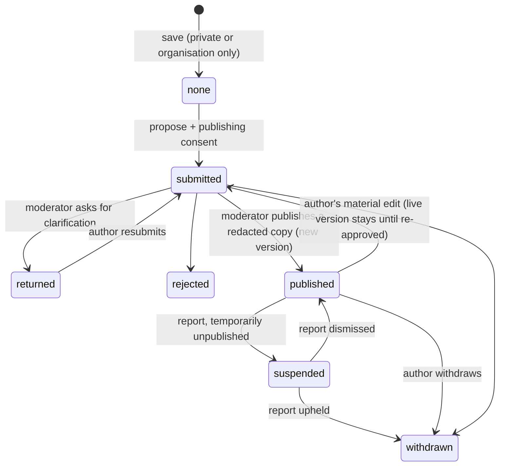

# azentio.ai: website and governed collaboration portal

This is a hackathon build of the azentio.ai public site plus a secure portal. In the portal:
- employees and clients each get their own workspace;
- client market observations become moderated, de-identified shared learning;
- product owners turn recurring themes into improvement ideas, without exposing any client's private information.

All organisations, people and figures are fictional. Synthetic data only.

**Scope choice.** The brief is large, so this build covers its own end-to-end scenario (brief §10) and the access rules end to end, plus AIRA, an AI summary that cites only approved contributions. The rest is listed under "Not built".

## Run it

```bash
uv sync                      # or: pip install -r requirements.txt
uv run uvicorn app.main:app --port 8090
uv run pytest -q             # 124 tests
```

- Open http://localhost:8090 and choose **Sign in**, then a demo persona.
- Sign-in uses a one-time email code. No email provider is configured, so the code appears on screen in a clearly labelled **demo mailbox**.
- Optional: set `GROQ_API_KEY` for AIRA. Without it, AIRA shows the matching approved contributions with citations and no summary.

Settings (environment variables):

| Setting | Default | Meaning |
|---|---|---|
| `PORTAL_DB` | `portal.db` | SQLite file. It is created and seeded on first start. |
| `MIN_COHORT` | `3` | Distinct organisations a theme needs before clients see it. |
| `SMALL_SAMPLE` | `5` | Below this, themes carry a "small sample" warning. |
| `DEMO_MAILBOX` | `1` | Show codes and invitations on screen instead of emailing them. |
| `GROQ_API_KEY`, `AIRA_MODELS` | none; `openai/gpt-oss-120b,openai/gpt-oss-20b` | AIRA provider and the order in which models are tried. |

## Demo guide

- Open **`/demo`** on the running site.
- Each step has one button that signs in as the right persona and opens the right page. It runs on the server, so that persona's real permissions apply.
- **Reset demo data** puts everything back to the starting state.
- The **View as** menu in the header switches persona from any page.
- Both the menu and the reset are demo-only: they exist while `DEMO_MAILBOX=1`, accept only the seeded personas, and are audited. Turn the flag off and they return 404.

## Five-minute demo (the brief's seasonality scenario)

1. **Public.**
   - The homepage, products, media and demo request are open to everyone.
   - `/api/v1/shared` returns **401**, and employee or entitled media under `/media/{id}` return **404**.
2. **Asha (Kestrel Bank, client admin).**
   - The dashboard shows Kestrel's entitlements, demos, its own observations and the shared themes.
   - The "Seasonality context" theme is **hidden**, because only 2 organisations have contributed so far.
   - Create an observation. It is saved private, and nothing is shared.
3. **Omar (moderator).**
   - The queue holds Meridian's seasonality contribution. The scan flags an account number.
   - Publishing it verbatim is **refused**. Redact it, then publish into "Seasonality context".
   - Meridian's author is notified in the app.
4. **Asha again.**
   - The theme now appears with 3 organisations and a **small sample** warning, linked to the de-identified evidence.
5. **Priya (product owner).**
   - Create "Seasonality-aware comparison explanation" for Financial Analysis Intelligence with status **Under review**.
   - Contributors are notified. Clients see the status and public note, never the internal problem statement.
6. **Sam (Northwind).**
   - Withdraw the shared contribution.
   - It leaves the feed, search, theme counts and AIRA **in the same transaction**. Ask AIRA again to show this.
7. **Arjun (portal admin).**
   - The audit log shows every step, with the hash chain verified.
   - Arjun cannot open any client's private draft.

## Code conventions

- **`app/constants.py`** is the single source for fixed values:
  - every URL as a `Route` enum, used for route decorators, redirects and links (`Route.OBSERVATION.url(oid=7)`);
  - roles, permissions, audiences and lifecycle states as `StrEnum`s.
- **Schema checks:** the database `CHECK` constraints are generated from the same enums, so the schema cannot drift from the code.
- **Form input:** untrusted values are turned into enum members at the service boundary with `parse()`.
- **Templates:** they use the same enums as Jinja globals (`R.LEARNING`, `ShareState.PUBLISHED`). No template hardcodes a path.

## Access model (server-side, every request)

- **Sign-in codes.** Each address can request at most 5 codes per 15 minutes. A new code does not reset failed attempts on an unexpired one.
- **Identity.** A session is a random token in an `HttpOnly`, `SameSite=Lax` cookie. Only its hash is stored. The server resolves the user, their **active** memberships and their grants on every request (`auth.load_ctx`).
  - No authority comes from the menu, browser storage, the email suffix or a tenant ID supplied by the client.
  - `newhire@azentio.com` with no approved membership gets nothing.
- **Active workspace.** A user with several memberships must pick one; the choice is checked against their memberships. Everything they see is then scoped to that organisation.
- **Least privilege (IAM-02).** `moderate`, `publish_content`, `portal_admin` and `product_owner` are separate grants. They count only inside an active Azentio employee workspace. Being an employee implies none of them.
- **Resource audience** is required: `public | employees | org | entitled` (`policy.can_view_resource`). A missing or unknown audience means **deny**, never "public".
  - The same check guards pages, `/api/v1/*` and `/media/{id}`.
  - Private media is sent with `Cache-Control: private, no-store`.
- **Observations.**
  - The author always sees their own.
  - Organisation members see those marked "My organisation".
  - Moderators see a contribution **only while it is submitted, published or suspended**. Once they return or reject it, they lose sight of it until it is resubmitted, because the author may edit it privately again.
  - Portal admins get no implicit access.
  - Objects you may not see return **404**, so their existence is not disclosed.
- **Client administrators** invite and revoke only within their own organisation, and grant only `member` or `admin`.
  - Invitations are single-use, expire after 7 days, are stored hashed, and can be accepted only by the verified invited email after accepting the terms.
  - Joining a workspace is not consent to share anything.

## Identity administration

- **Employee provisioning.** An `@azentio.com` sign-in without a membership gets nothing.
  - The person requests access, and a portal administrator approves or declines.
  - Approval creates an employee membership only; it implies no platform permission.
- **Platform grants.** Moderator, publisher, product owner and portal administrator are toggled separately.
  - They can be granted only to approved employees.
  - An administrator cannot remove their own admin grant. Every change is audited.
- **Entitlements.** Administrators grant or remove offerings per client organisation. Entitled demos and media follow immediately.
- **Support access** (brief §03: "explicit support authorisation, not merely a broad UI role"):
  1. An administrator requests access to one client organisation and gives a reason.
  2. That client's administrator approves or declines it.
  3. Approved access lasts 30 minutes and covers records shared inside the organisation, never private drafts.
  4. Every listing and read is audited. Either side can end it early.
- **Client roles.** Client administrators switch members between member and admin, but cannot remove the last admin.
- **Resource audiences.** Content publishers set who may open each resource, including video: public, employees, clients entitled to an offering, or one organisation.
- **My access** (`/access`) shows each capability for the current account, whether it is allowed, and why.

## Playground

- **Four deterministic sandboxes on synthetic data:**
  - SME credit policy checks (DSCR, leverage, current ratio, years trading);
  - a credit-policy simulator over 400 synthetic applications against a baseline;
  - seasonal-versus-real decline for monthly revenue (the seasonality theme, working);
  - validation of a regulatory return.
- **Results:** every result shows each check, its value and what it was compared with, and is labelled as a simulation, not a decision.
- **Access:** employees see every sandbox. Clients see only those their active organisation is entitled to, checked on the server for both the page and the run.
- **Privacy:** runs are private to their author within that workspace.
- **AIRA explanation:** optional, using only that run's synthetic data.
- **Feedback:** ratings and comments reach product owners aggregated, without names or organisations.

## Learning lifecycle



- **The private source** (`observations`) and **the shared copy** (`shared_items`) are separate tables.
  - The shared copy holds only reviewed fields: title, text, offering, topic, period, evidence type, confidence, a coarse sector (Banking, Lending and so on, never the organisation's own industry label), a coarsened region, and optional opt-in attribution.
  - Shared payloads never contain tenant, author, observation, moderator or scan fields (tested).
- **Consents are recorded separately:** storing (implicit in saving privately), publishing, attribution, and future training. No training programme runs, and nothing is trained.
- **The sensitive-content scan** flags account and card numbers, emails, PAN- and IBAN-like strings, phone numbers and confidential terms.
  - It is a prompt for the moderator, not a privacy guarantee.
  - Publishing still-flagged text needs an explicit override.
- **Reports.**
  - Any participant can report a shared item.
  - Moderators can unpublish it during review, then uphold or dismiss.
  - The contributor learns the decision, never who reported it.
- **Notifications** are persisted in-app records. Nothing is labelled "email delivered".

### Withdrawal and propagation

- **In this build:** withdrawal removes the shared versions from the full-text index, themes and AIRA retrieval in the **same database transaction**, so it is effective at the next request (tested).
- **Proposed production SLA:** 60 seconds across replicas, caches and any vector index. Index deletes would go through an outbox, with cache invalidation keyed on the shared-item ID.
- Material already read by participants, and any copies they made elsewhere, cannot be recalled.
- Retention: consent history, approved versions and moderation decisions are kept as the audit record.

### Aggregation safeguards

- Theme statistics count **distinct organisations**. Repeated posts from one organisation count once.
- A theme is hidden from clients until `MIN_COHORT` (3) organisations contribute. Its items are also left out of client search, filters and AIRA until then. Moderators and product owners see it earlier, with a warning. Ideas can link only themes that meet the cohort.
- Themes below `SMALL_SAMPLE` carry a warning that they are an early signal, not prevalence or causation.
- A minimum cohort size alone is not a privacy guarantee. The production threshold and suppression policy need approval before launch.

## AIRA (AI-assisted synthesis)

- **Retrieval** uses only `published` shared items, through the same visibility check as the feed. Private records, employee content and withdrawn items are never sent to the provider (tested).
- **Prompt-injection guard:** the evidence goes inside delimiters, and the model is told that evidence text is data, not instructions.
- **Citations** (`[S12]`) are checked after the answer: any ID that was not retrieved is stripped (tested).
- **Limits:** 8 questions per user per minute. Public visitors cannot use AIRA.
- **Failover:** Groq `openai/gpt-oss-120b`, then `openai/gpt-oss-20b`, then a non-AI listing of the matching items.
- Summaries do not retrain any model. This is not federated learning.

## Requirement coverage

| Brief area | Status |
|---|---|
| Public site: catalogue, products, media, insights, demo request, hackathon registration | Built |
| IAM-01/02: RBAC, tenant membership, audience, entitlements, active workspace, least privilege | Built and tested through the API and media routes |
| Portal admin: organisations, grants, employee provisioning, client-approved support access | Built |
| Client admin role changes; content publisher resource audiences | Built |
| Sign-in | Email one-time code with expiry and a 5-attempt lock; codes shown in the demo mailbox. **Entra ID OIDC is not integrated.** |
| Client invitation journey and terms | Built |
| Client dashboard, entitled demos, My and organisation observations, shared feed with filters | Built |
| Observation capture, validation (client and server), draft / submit / edit-returned / withdraw | Built; attachments omitted (allowed in P0) |
| Moderation: redact, clarify, reject, publish versions, reports, suspend | Built |
| Sharing choices, separate consents, de-identified shared copy, cohort threshold | Built |
| Themes, improvement ideas, audited status, contributor updates | Built |
| AIRA with checked citations | Built |
| Employee dashboard, employee-only content excluded from client search and AIRA | Built (internal notes, recordings, release notes) |
| Guided Playground (employees: all sandboxes; clients: entitled only), evidence, AIRA explanation, structured feedback | Built |
| Live sessions and recordings with audiences; knowledge library with owners, review dates and feedback | Built |
| Experiment submissions, hackathon team spaces | **Not built** |
| Differencing-safe filters, audited CSV export, consent history | Built |
| Useful / needs-evidence votes, moderator evidence quality, duplicate check, ideas citing contributions | Built |
| Prototype public routes: Solutions, AI Lab, Technology, Insights | Built |
| Configurator: cohort minimum, small-sample warning, support duration, invitation expiry, AIRA switch and rate, publishing pause (validated, audited) | Built |
| Email delivery (P1), saved searches, bookmarks, comments | **Not built** |
| Federated model-learning track (P2) | **Not built** |

## Known limits

- **Hosting:** the free Render instance uses an ephemeral SQLite file. Each restart reseeds the demo data, and the instance sleeps after 15 idle minutes, so the first request is slow.
- **CSRF:** protection relies on `SameSite=Lax` cookies. A per-form token is the next step.
- **Rate limiting:** the AIRA limit is in memory, per process.

## AI tools used

- **Building:** developed with Claude Code, an AI coding assistant.
- **At runtime:** AIRA calls Groq-hosted open-weight models (`gpt-oss`).
- No Azentio confidential data, HealthPlix code or real customer data is used.
